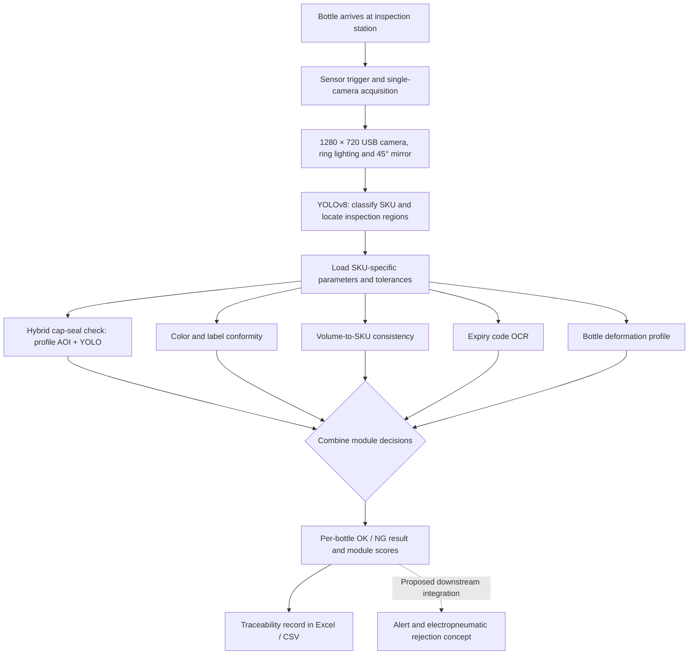

# System Architecture and Inspection Workflow

This diagram is a **redrawn explanatory schematic** based on the published research, not a screenshot of deployed MES software or the original implementation.

## How this connects to MES / MOM

The project demonstrates how an inspection system can generate **item-level quality decisions and traceability records**, the type of production information used by MES/MOM applications. It **does not claim an actual MES integration or a commissioned production-line rejector**.

## Optical and calibration assumptions

- One fixed USB camera operating at 1280 × 720 pixels.
- Ring illumination, controlled background and 45° mirror arrangement.
- SKU-specific regions of interest, JSON configuration and calibrated tolerance thresholds.
- Changes in camera position, product presentation or lighting may require recalibration.

## Key engineering contributions

1. Combining learned SKU detection with interpretable, deterministic inspection criteria.
2. Using complementary cap-sealing methods to reduce weaknesses of a single test.
3. Producing per-item inspection decisions plus module-level traceability data.
4. Designing a possible link between quality decisions and reject/alert workflows.

**Source:** [Negm et al. (2026), The International Journal of Advanced Manufacturing Technology](https://doi.org/10.1007/s00170-026-18704-3).
