# AOI thesis figure gallery

Original figures extracted from the BSc thesis. Figure numbers and pages refer to the thesis.

[Back to the project overview](README.md)

## Implemented inspection-cell block diagram

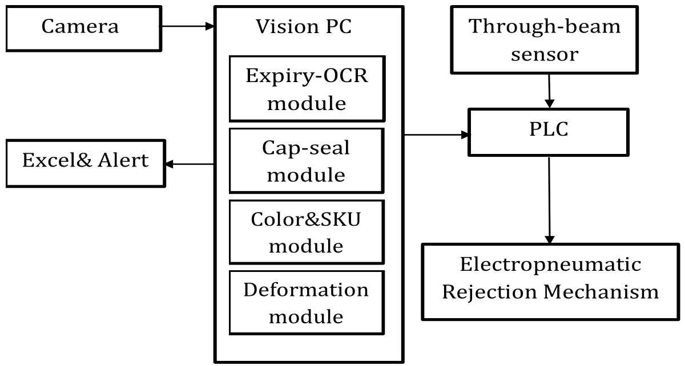

*Source: Thesis Fig. 18, p. 49.*

## Physical prototype setup

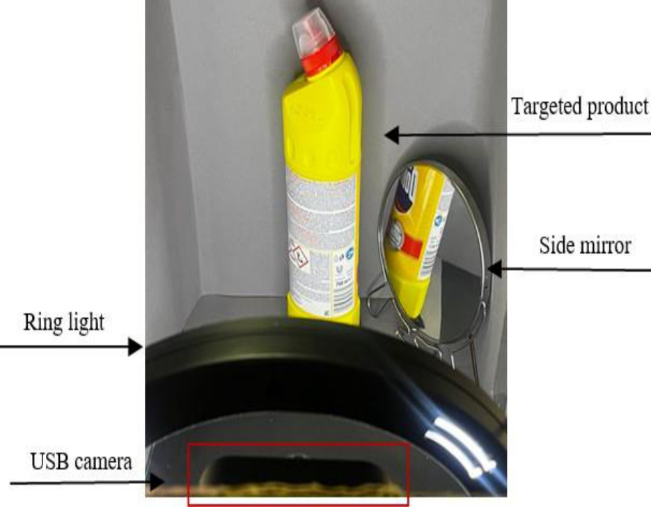

*Source: Thesis Fig. 28, p. 58.*

## Color-label inspection with an on-screen mismatch

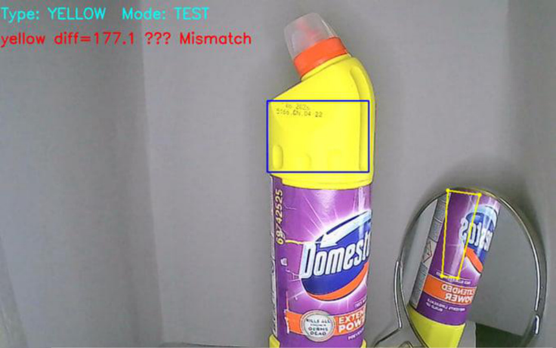

*Source: Thesis Fig. 29, p. 60.*

## Color-label inspection with an on-screen match

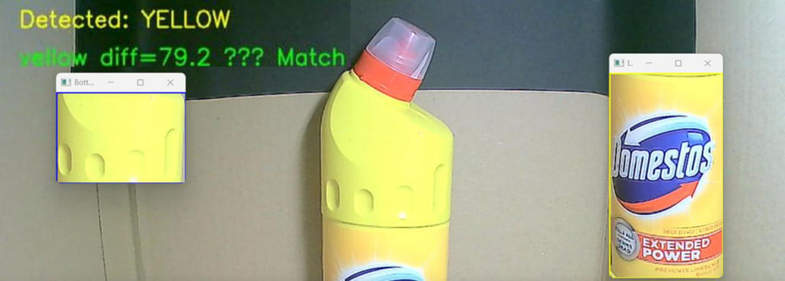

*Source: Thesis Fig. 30, p. 60.*

## Mismatched SKU and volume

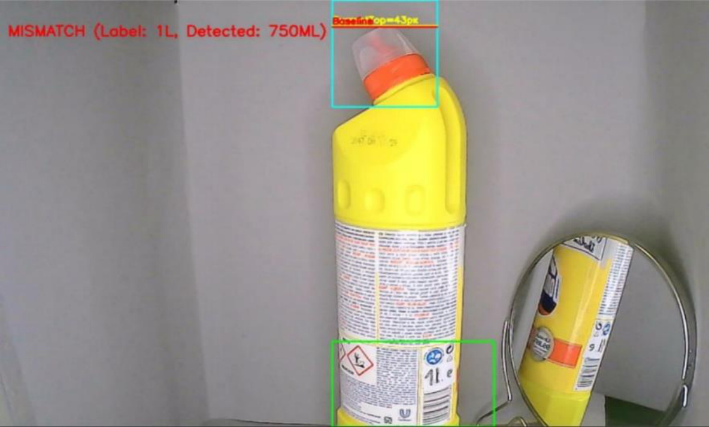

*Source: Thesis Fig. 31, p. 62.*

## Matched SKU and volume

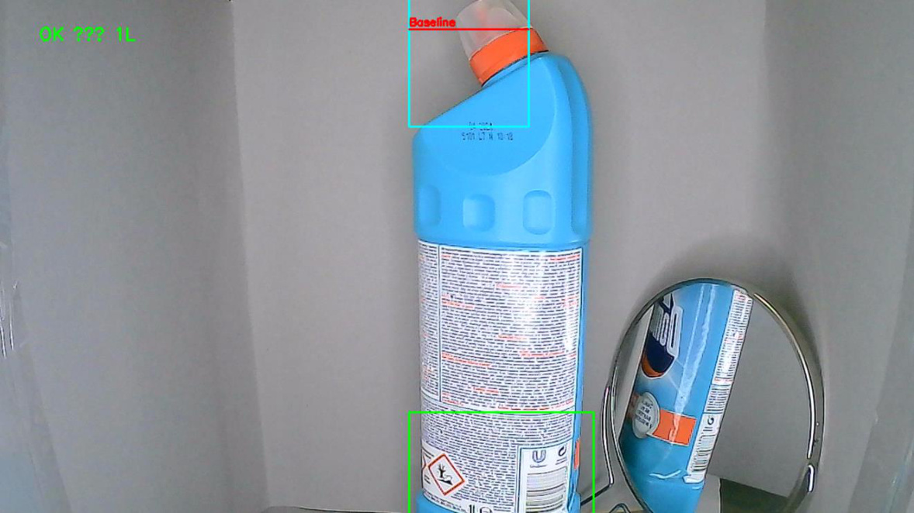

*Source: Thesis Fig. 32, p. 62.*

## Unclear expiry-date example

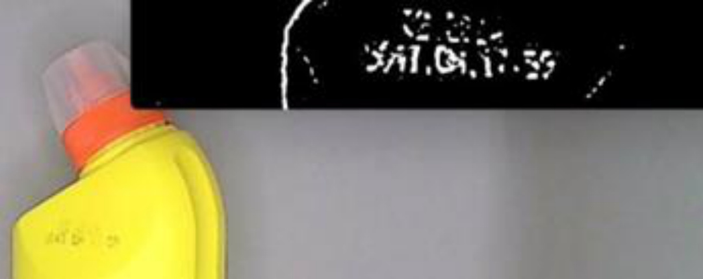

*Source: Thesis Fig. 33, p. 64.*

## Clear matched expiry-date example

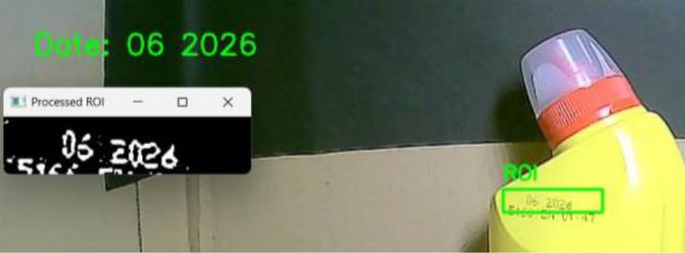

*Source: Thesis Fig. 34, p. 65.*

## Correct sample: stable width profile

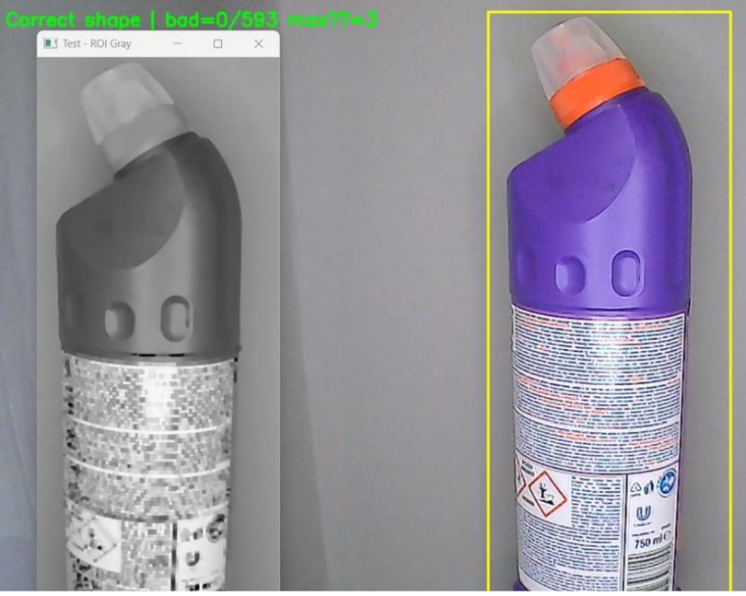

*Source: Thesis Fig. 38, p. 68.*

## Defective sample: high row violation

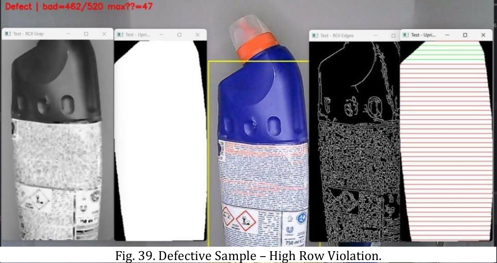

*Source: Thesis Fig. 39, p. 68.*

## Excel inspection logging

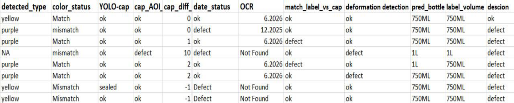

*Source: Thesis Fig. 40, p. 69.*

## Mechanical rejection-actuator design

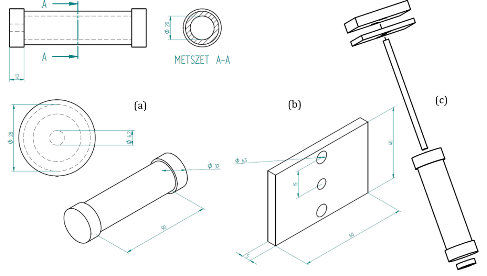

*Source: Thesis Fig. 42, p. 74.*

## Electropneumatic rejection circuit in FluidSIM

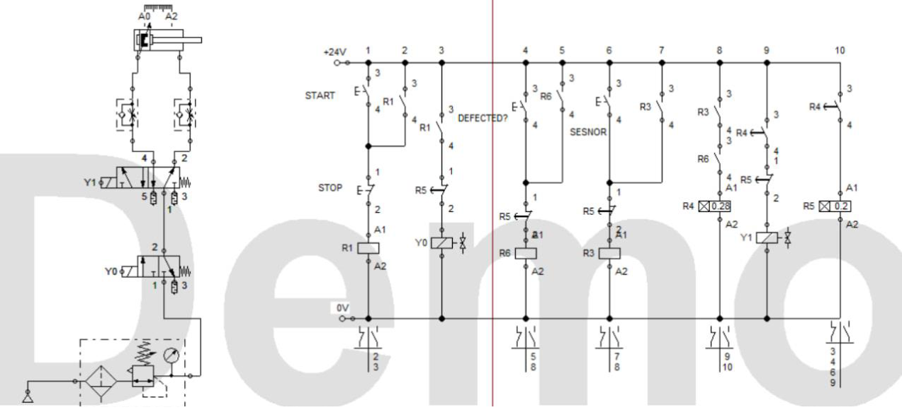

*Source: Thesis Fig. 43, p. 76.*

## PLC Boolean transition

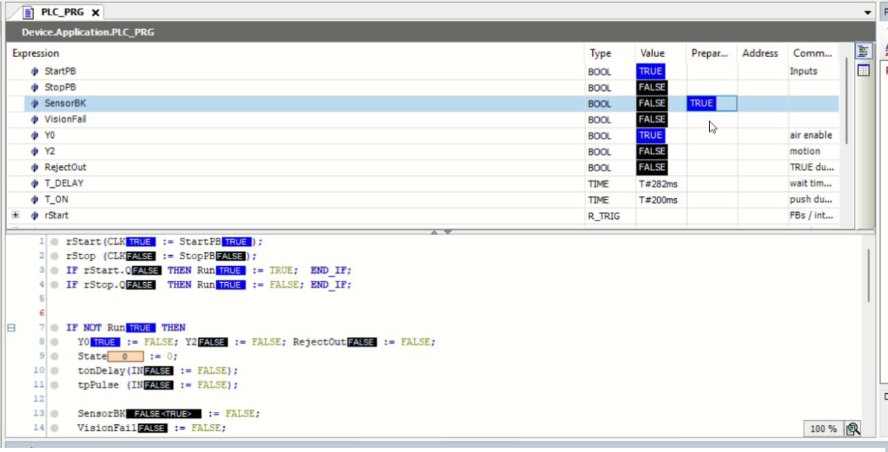

*Source: Thesis Fig. 44, p. 78.*

## Real-time overlay: conforming yellow bottle

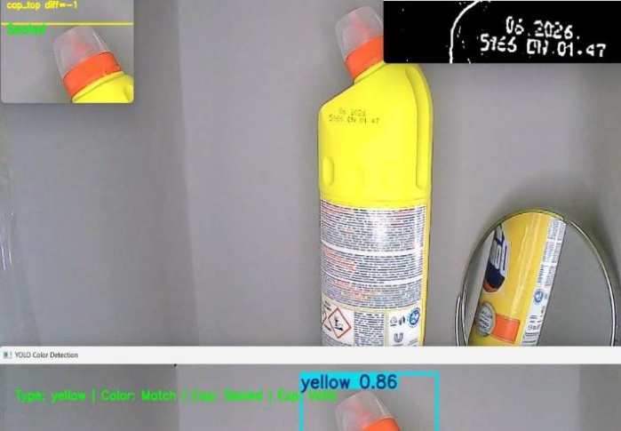

*Source: Thesis Fig. 51, p. 84.*

## Real-time overlay: purple bottle with missing expiry code

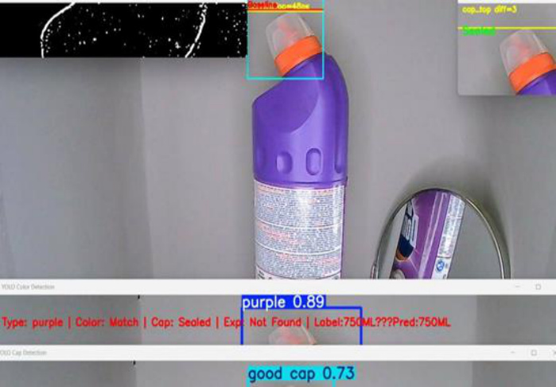

*Source: Thesis Fig. 52, p. 84.*

The thesis captions for Figures 29 and 30 appear reversed relative to their on-screen Match/Mismatch status. The gallery descriptions follow the visible inspection status; the source figure numbers are retained.
