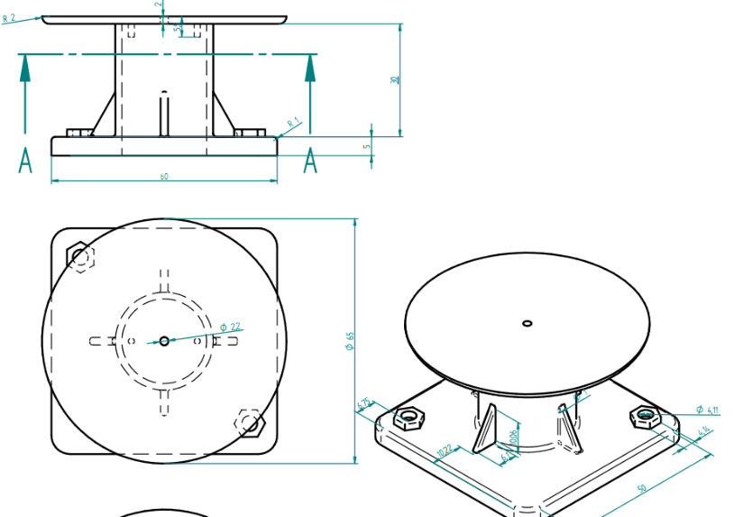
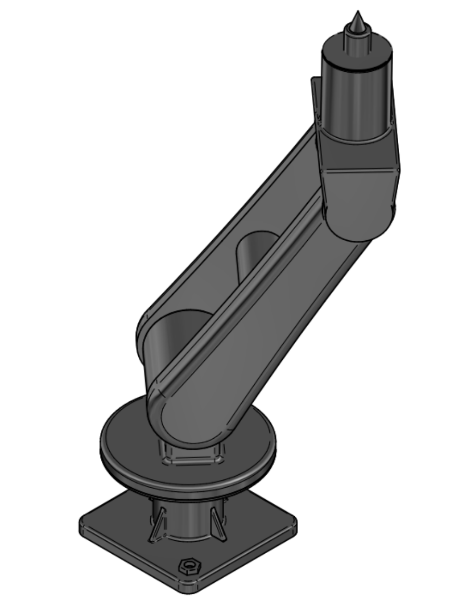
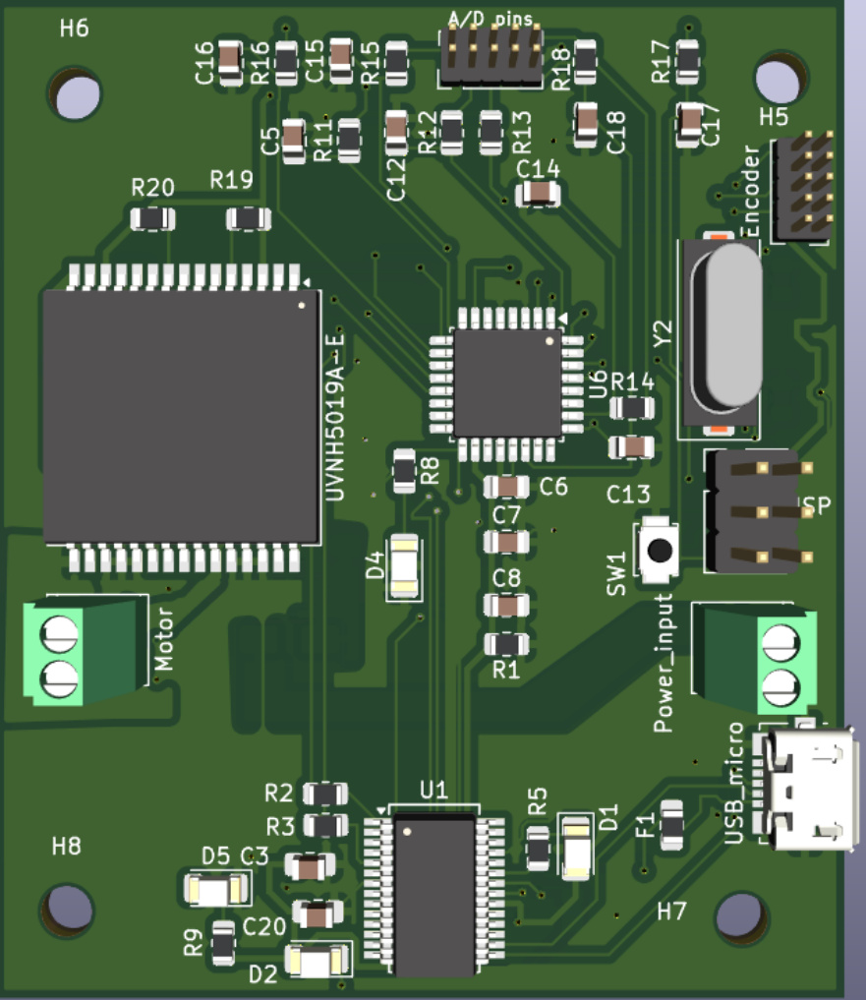
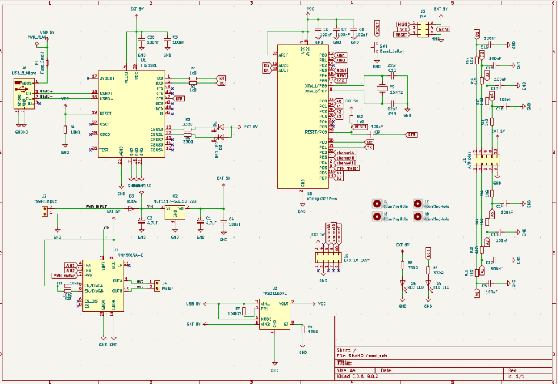
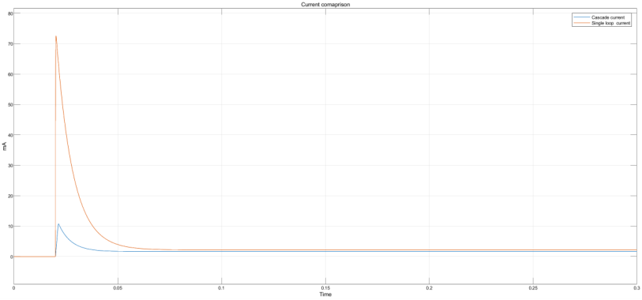
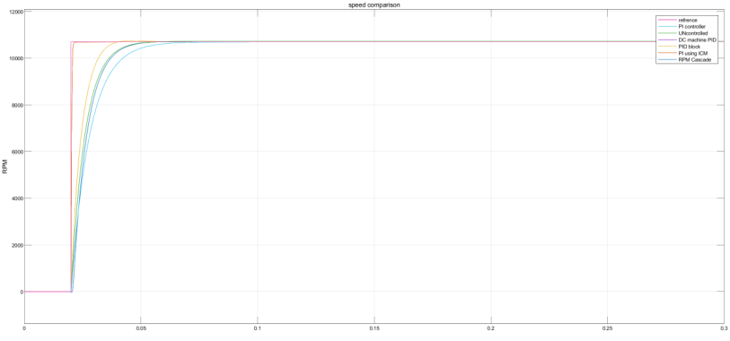
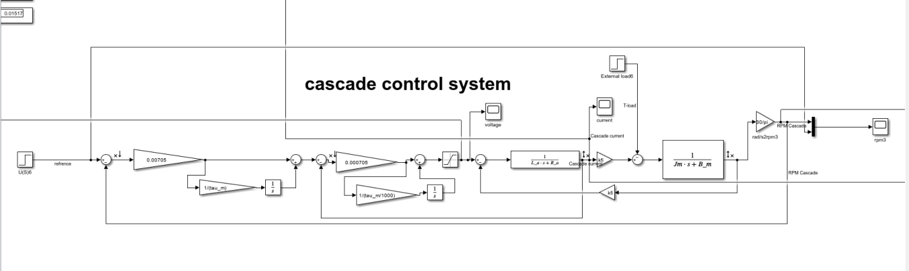

# Robotic-arm figure gallery

Original figures extracted from the [design report](Project-description.pdf) and [motor-control report](PID/PID-analysis.pdf). Page numbers below refer to PDF pages.

[Back to the project overview](README.md)

## CAD model of the base and first motor

*Source: Design report Fig. 1, PDF p. 3.*

## Final assembly of the four-DOF robotic arm

*Source: Design report Fig. 2, PDF p. 4.*

## Motor-controller PCB layout in KiCad

*Source: Design report Fig. 3, PDF p. 6.*

## Motor and encoder wiring diagram

*Source: Design report Fig. 4, PDF p. 6.*

## Simulated current response with cascade control

*Source: Design report Fig. 5, PDF p. 8.*

## Simulated controller-response comparison

*Source: Design report Fig. 6, PDF p. 8.*

## Cascade Simulink model: inner current loop and outer speed loop

*Source: Motor-control report Fig. 9, PDF p. 11.*

